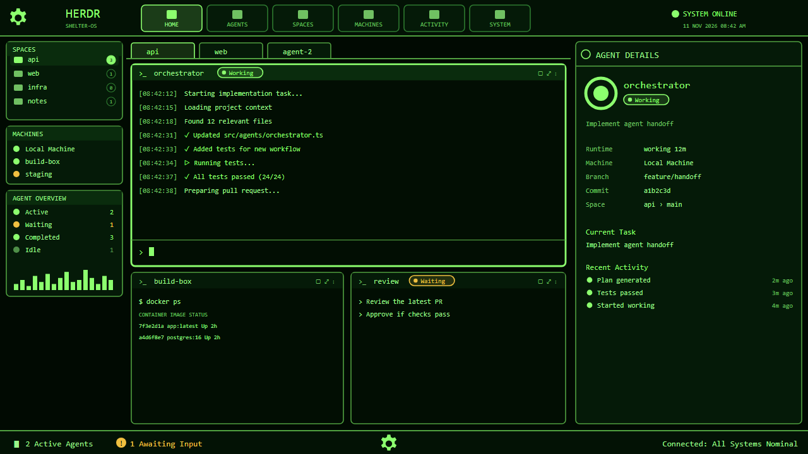

# Shelter v2

A green-phosphor operations console layout for [Herdr](https://herdr.dev): near-black
panels, green text and borders, six view tiles across the top, and a gear that
spins on every working agent. It comes in three dark themes: calm **Sage** (default),
warm **Amber** and the original bright **Green**, picked in Settings > Look > Theme.
Sage and Amber are tuned for long hours and low light (design guidance, not medical
advice; for persistent eye strain see an optometrist).



Unofficial, personal project. Not affiliated with or endorsed by Herdr or any game
publisher. Tested on Windows only. AI Assisted.

## What's in it

| Path | What it is |
|---|---|
| `layouts/shelter_v2.json` | the layout (header, sidebar, deck of six views, details panel, status bar) |
| `layouts/shelter_v2.svg` | the picture Herdr's settings screen shows for the layout |
| `mods/shelter_v2/` | the mod that draws every screen, with its icons and fonts |
| `themes/shelter_v2_sage.json`, `shelter_v2_amber.json`, `shelter_v2.json` | the three palettes (Sage is the layout's default; `shelter_v2` is the original green) |
| `keys.json` | the `layout:shelter_v2` keys section to merge into yours |
| `RECIPE.md` | the full brief: what you see, behavior, how it is built, what to watch for |

## Install

Herdr's app folder is `~/.config/herdr-app` (on Windows, `C:\Users\<you>\.config\herdr-app`).
Copy these in without replacing anything of yours:

```sh
cp layouts/shelter_v2.* ~/.config/herdr-app/layouts/
cp -R mods/shelter_v2   ~/.config/herdr-app/mods/
cp themes/shelter_v2*.json ~/.config/herdr-app/themes/
```

Then:

1. **Keys:** add the `layout:shelter_v2` section from `keys.json` to your own
   `~/.config/herdr-app/keys.json` by hand. Herdr treats an edited `keys.json` as
   yours, so don't copy the file over it. Ctrl+Shift+I toggles the details panel and
   Alt+Shift+1 to 6 pick Home, Agents, Spaces, Machines, Activity, System.
2. **Theme names:** the layout uses `shelter_v2_sage`. If you already have a theme with one
   of these names, rename it and the layout's `theme` field together. Switch themes in
   Settings > Look > Theme (all three are listed under Dark).
3. Check and switch:

   ```sh
   herdr-app check ~/.config/herdr-app/mods/shelter_v2
   herdr-app do layout.switch --name shelter_v2
   ```

   `Ctrl+Shift+L` cycles back to your other layouts, and deleting the files removes this one.

## What the mod runs

It runs `git rev-parse --short HEAD` in a pane's folder (the details panel),
`herdr-app status` (System view), and opens herdr.dev documentation links in your
browser. It makes no network requests itself and reads no files outside its own
folder. Read the code before you install it: the folder is small.

## License

Code, icons, layout and themes: MIT, see [LICENSE](LICENSE). The bundled fonts (IBM Plex
Mono, Share Tech Mono, VT323) keep their own SIL Open Font License; the licence texts are
in `mods/shelter_v2/fonts/`.
