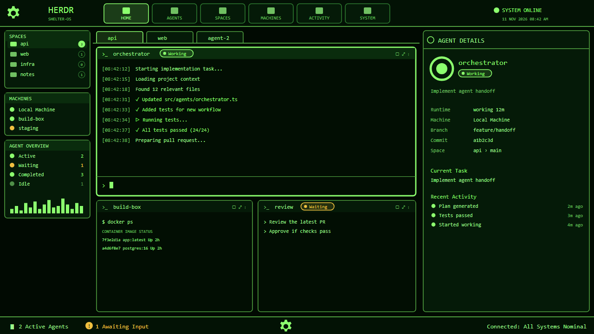

# Shelter v2

A green-phosphor operations console for Herdr, branded "SHELTER-OS": near-black
panels, bright green text and borders, and a gear that spins on every working
agent. A header with six view tiles, a sidebar of spaces, machines and an agent
overview, bordered terminal cards, an agent-details panel on the right and a status bar.

Unofficial, made for personal use. Tested on Windows only. AI Assisted.

## What you see

- **Header (76 px, drags the window):** a gear emblem, `HERDR`, `SHELTER-OS v<app
  version>`; six nav tiles (Home, Agents, Spaces, Machines, Activity, System), the
  shown one lit; `SYSTEM ONLINE` with the date and clock; small search, palette,
  bell and details buttons and the window buttons.
- **Sidebar (290 px, 44 to 380):** bordered panels. Spaces (agent-count badge per space,
  New Space…), Machines (status dot; Add Machine…) and Agent Overview (Active,
  Waiting, Completed, Idle and a 24-hour activity histogram). Machines and Agent
  Overview fold. Narrower than 160 px it becomes a rail.
- **Home:** a 46 px tab bar (drag a tab onto another to reorder), then pane cards:
  1 px border, 2 px accent border when focused, 10 px gap, 6 px radius, a 40 px header
  with icon, name, status pill, split, zoom and menu buttons. A lone pane is framed too.
- **Agents, Spaces, Machines, Activity, System:** full-width views that replace Home in
  the same area (the layout's `deck` stack).
- **Agent Details (400 px, 300 to 560; Ctrl+Shift+I):** status ring and pill, current
  task (the terminal title), runtime, machine, branch, commit, recent activity, and
  Open terminal / Peek / Pin.
- **Status bar (44 px):** active agents, awaiting input (amber when any), a centered
  gear, and the connection state.
- **Type:** terminals IBM Plex Mono 14 px; interface Share Tech Mono; headline mark
  VT323. All three are bundled in `mods/shelter_v2/fonts/` with their OFL licences.
- **Colors** (`themes/wasteland_v2.json`): canvas `#010a02`, background `#020e03`,
  panel `#051a08`, borders `#2e7a30` and `#50a040`, text `#9cf58a`, accent `#8cff6e`,
  waiting amber `#f0c040`, error red `#f06050` (set in `look.js`), idle `#7c9a78`.
  Panels carry a thin scanline layer (`scanlines.svg`), switched off by
  System > Appearance > CRT scanlines.

## How it behaves

| Agent status | Label | Icon | Tone |
|---|---|---|---|
| `blocked` | Waiting | alert | amber |
| `working` | Working | gear, turns once per 2600 ms | accent green |
| `done` | Completed | check | green |
| `idle` | Idle | idle mark | grey-green |

- A machine shows Connected (dot), Connecting (spinner, 1100 ms turn) or Unavailable (red).
- Status is always an icon plus a word, never color alone. The spinning icons stop when
  System > Appearance > Motion is off.
- Nav tiles run `layout.select` on the `deck` stack. Keys (`keys.json`):
  `ctrl-shift-i` toggles the inspector; `alt-shift-1` to `alt-shift-6` pick Home,
  Agents, Spaces, Machines, Activity, System.
- The bell and Awaiting Input open the notifications popup at `y: 80`, right-aligned,
  360 x 440 px. Right-clicking a space or a pane opens Herdr's shipped `menu`; New agent
  and the tab bar's + open the shipped `new-menu`.
- The sidebar's width and folded panels are remembered; Appearance choices too.

## Built from

- `layouts/shelter_v2.json`: root column (header 76, `body` row, status 44;
  `titlebar: none`; `theme: wasteland_v2`; `preview: layouts/shelter_v2.svg`). The body
  row holds `sidebar` (290), the `deck` stack (`terminal`, `board`, `spaces`,
  `machines`, `activity`, `system`) and `inspector` (400).
- One mod, `mods/shelter_v2/`, in which `props.view` picks the screen: `header`, `nav`,
  `tabs`, `pane`, `board`, `spaces`, `machines`, `activity`, `system`, `inspector`,
  `status`, `alerts`, `menu`. Files: `main.js`, `look.js` (tokens and shared
  components), `model.js` (states), `activity.js`, `view-shell.js`, `view-ops.js`,
  `view-records.js`, `view-system.js`, `view-terminal.js`, `icons/` (outline SVGs, tinted by
  text color), `fonts/`, `scanlines.svg`. `mod.json` has `"place": "none"`.
- `themes/wasteland_v2.json`: the palette above.
- `keys.json`: the `layout:shelter_v2` section only.
- Shipped mods it calls: `menu`, `new-menu`.
- From `herdr`: `run`, `spaces`, `machines`, `panes`, `layout`, `keys`, `window`,
  `updates`, `shared` / `setShared` (keys `shelter_v2.prefs`, `.selection`,
  `.sidebarWidth`), `openOverlay`, `setAgentOrder`, `nextCommand`, `exec`, `home`.
- Art: none from outside. The gear is `icons/gear.svg` (6 teeth, centered on 8,8).

## Watch out

- **It runs programs and opens links.** Via `exec`: `git rev-parse --short HEAD` in a
  pane's folder (Agent Details, 5 s limit), `herdr-app status` (System view, 8 s), and
  `cmd /c start` / `open` / `xdg-open` to open herdr.dev documentation links in the
  browser. It makes no network requests itself and reads no files outside its folder.
- `keys.json` is a section to merge, not a file to copy over yours: Herdr keeps an
  edited `keys.json` as yours. Add the `layout:shelter_v2` section by hand.
- Install the theme too: the layout names `wasteland_v2`. If you already have a theme
  with that name, rename this one and the layout's `theme` field together.
- This is a fork of a Wasteland layout, so some leftovers remain: the class in
  `main.js` and a few comments still say Wasteland. System > Preferences lists
  shortcuts from the section `layout:shelter_v2`, so keep the section name in
  `keys.json` as it is, or change it in `view-system.js` too.
- A spun icon must be centered on its viewBox, or it wobbles as it turns (the first
  gear drew its hole off center). Keep every spun icon centered on 8,8, with no
  `transform`, and bold at 12 px.
- Panels draw solid backgrounds, so each panel draws its own scanline layer: one
  screen-wide layer wouldn't show inside them.
- `svg()` tints a whole icon one color: draw icons as outlines.
- Not tested on macOS or Linux.

## Done when

- `herdr-app check ~/.config/herdr-app/mods/shelter_v2` passes.
- After `herdr-app do layout.switch --name shelter_v2`, `herdr-app status` shows
  layout `shelter_v2` and no errors.
- Each of the six nav tiles shows its own view, and `alt-shift-1` to `alt-shift-6` do the same.
- `ctrl-shift-i` hides and shows Agent Details.
- With an agent working, its pill shows a gear that turns around its own center: no
  second ring, no drift.
- System > Appearance > Motion off leaves the gear still.
